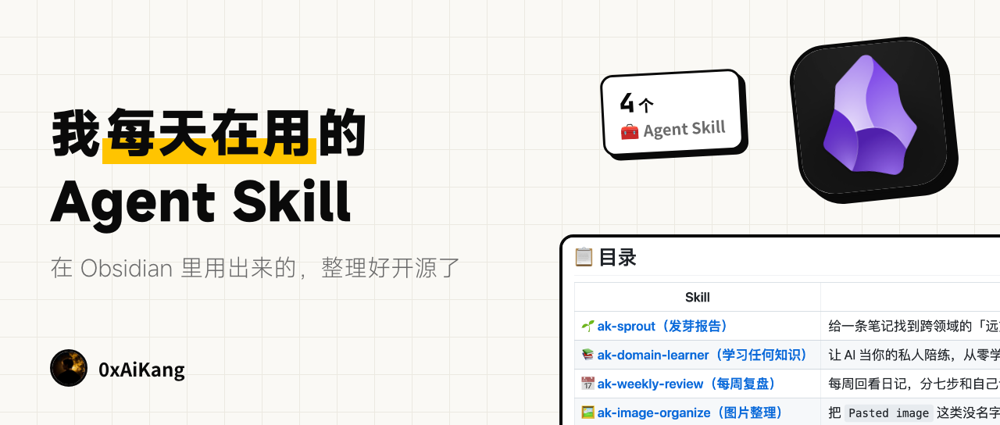
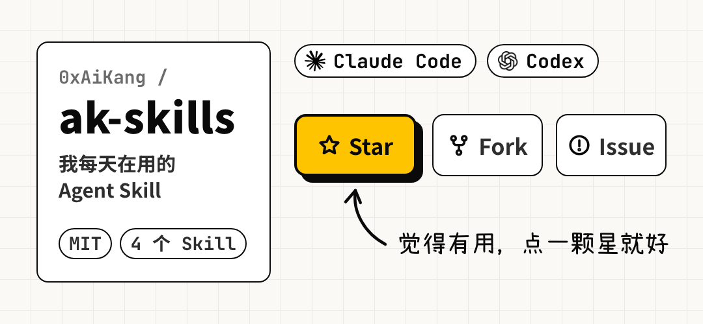

<div align="center">



# ak-skills

#### 我每天在 Obsidian 里用的几个 Agent Skill，整理好放在这里了

[](./LICENSE)
[](#-skills)
[](https://agentskills.io)


</div>

这几个 Skill，是我最近几年在 Obsidian 里做知识管理时，一点点攒下来的。

原本只是写给自己用的，里面写死了我的目录、我的标签、我的日记模板，别人拿过去基本跑不起来。这次开源，我把这些个人的东西都抽到了配置文件里，方法本身没有改。

它们遵循 [Agent Skills](https://agentskills.io) 开放标准，Claude Code、Codex 等支持该标准的 Agent 都能装。

> [!NOTE]
> **关于 Obsidian**
>
> 这些 Skill 都是我在 [Obsidian](https://obsidian.md/) 里用出来的，所以设计上按 Obsidian 的习惯来：双链、块引用、frontmatter。
>
> 但它们不都依赖 Obsidian。下面的目录里标了每个 Skill 需不需要它，不用 Obsidian 的话，挑标着「不需要」的用就行。

---

## 📋 目录

| Skill | 一句话 | 需要 Obsidian 吗 | 讲解 |
|---|---|---|---|
| 🌱 [**ak-sprout（发芽报告）**](#ak-sprout) | 给一条笔记找到跨领域的「远方回响」，而不是更多同类 | 不需要，有更好 | [公众号文章](https://mp.weixin.qq.com/s/HoC0LYMtugQZpmvFjR2cHw) |
| 📚 [**ak-domain-learner（学习任何知识）**](#ak-domain-learner) | 让 AI 当你的私人陪练，从零学一个陌生领域，每章答对题才往下走 | 不需要 | [公众号文章](https://mp.weixin.qq.com/s/DF2-X_iXMMz6e28v3Da3EQ) |
| 📅 [**ak-weekly-review（每周复盘）**](#ak-weekly-review) | 每周回看日记，分七步和自己认真对一次话，找出藏在日常里的暗线 | 不需要，有更好 | [公众号文章](https://mp.weixin.qq.com/s/Urpm5AvEcXOKba-90T63Ig) |
| 🖼️ [**ak-image-organize（图片整理）**](#ak-image-organize) | 把 `Pasted image` 这类没名字的图，按内容改成认得出的名字，链接一个不断 | 必须 | [公众号文章](https://mp.weixin.qq.com/s/WXJZ1otbGe6xD0TjgqKOKQ) |

---

## 📦 安装

**用 skills 命令装（推荐）**

```bash
# 列出仓库里的 Skill，选你要的装
npx skills add 0xAiKang/ak-skills -g

# 只装其中一个
npx skills add 0xAiKang/ak-skills --skill ak-sprout -g
```

`-g` 表示装到全局，所有项目都能用。以后更新，跑一下 `npx skills update -g` 就行。

**让 Agent 帮你装**

在 Claude Code、Codex 这类工具里，直接说：

```
帮我安装这个 skill：https://github.com/0xAiKang/ak-skills/tree/main/skills/ak-sprout
```

把最后的 `ak-sprout` 换成你想装的那个。

**手动复制**

把 `skills/` 下对应的文件夹，复制到你的 Agent 读取 Skill 的目录里，比如 Claude Code 是 `~/.claude/skills/`。

你用的工具不支持 Skill 也没关系：把对应的 `SKILL.md` 全文贴进对话，让 Agent 照着做，大部分情况效果一样。图片整理例外，它要用到 `scripts/` 里的脚本，这个办法不适用。

---

## ⚙️ 第一次用

有三个 Skill 需要知道你的笔记放在哪：周复盘要找日记，发芽要知道报告存哪，图片整理要知道附件目录。

这些信息不写在 Skill 里，而是存在你自己电脑上的配置文件中：

```
~/.config/ak-skills/
├── ak-weekly-review.json
├── ak-sprout.json
└── ak-image-organize.json
```

不用自己建。第一次用的时候，Skill 会问你两三个问题（比如「日记放在哪个目录？」），然后把要写入的内容给你看，你同意了它才写。

为什么不直接放在 Skill 的文件夹里？

因为用 `npx skills update` 更新的时候，Skill 的文件夹会被整个替换，放在里面的配置会跟着丢。

每个 Skill 有哪些配置项，看 `SKILL.md` 里「读配置」那一节。学习任何知识不需要配置。

---

## ✨ Skills

<a id="-skills"></a>

<a id="ak-sprout"></a>

<table>
<tr><td>

### 🌱 ak-sprout（发芽报告）

> *「你种下一颗种子，它能结出什么果子，像开盲盒一样。」*

假如你在笔记里记了曾国藩的一句话：「既往不恋，当下不杂，未来不迎。」

搜「曾国藩」，你会得到更多的曾国藩。这是检索。

发芽做的是另一件事。它先读懂这句话的思想内核是「活在当下」，再跨过领域，去找共享同一个内核的东西。于是它会告诉你：爱因斯坦有一句流传很广的话，「我从不去想未来，因为它来得已经够快了」；《功夫熊猫》里的乌龟大师也说过「昨天是历史，明天是谜题，今天是礼物」。

三者没有一个共同的关键词，只共享那个内核。

这个点子来自 GET 笔记 App 里的「发芽」功能，我用 Claude Code 做了一个自己的版本。

**一份发芽报告有三块**

- 🌱 **远方的回响**：来自哲学、科学、文学、影视、历史等不同领域的 4–7 条共鸣，这是主角
- ⚓ **锚回你的笔记库**：如果某条回响正好和你已有的笔记撞上，建议你把它们链起来
- 🌰 **可种的新种子**：值得单独沉淀成一条笔记的想法

**两条规矩**

- **只提议，不动你的笔记。** 唯一自动写入的是报告本身，所有互链建议都等你点头
- **不编名人名言。** 拿不准原话的，只转述意思、标明出处；实在不确定，就标「待核」

**一个真实的例子**

我拿自己一周的日记跑过一次。它提炼出一个内核：「灵感是多源输入的延迟碰撞」，然后找到了简·雅各布斯的城市理论、达芬奇的跨域笔记本，还有 Steven Johnson 在《好创意从哪里来》里提出的「慢直觉」。

其中「慢直觉」，最贴近我那一周想说、却没说清楚的意思。

**怎么触发**

```
给这条笔记发芽
这段话能发芽吗：既往不恋，当下不杂，未来不迎
来点远方的回响
```

**需要 Obsidian 吗**：不需要。装了 Obsidian 和 Obsidian CLI 时，它会用自带的脚本在你的库里找可以互链的笔记；没有的话，就用 grep 按关键词搜。

→ [SKILL.md](./skills/ak-sprout/SKILL.md) · [公众号讲解](https://mp.weixin.qq.com/s/HoC0LYMtugQZpmvFjR2cHw)

</td></tr>
</table>

<a id="ak-domain-learner"></a>

<table>
<tr><td>

### 📚 ak-domain-learner（学习任何知识）

> *「速度不是学习的目标，理解才是。」*

前段时间，我接了一个完全陌生领域的开发项目，留给我建立全局认知的时间只有一两周。

这次我没去买书、刷视频，而是全程让 AI 当老师。两天时间，把 9 个章节的核心内容过了一遍。

这个 Skill，就是把那次的做法固定了下来。

**它怎么教**

1. 先问你三个问题：你最熟悉的相邻领域是什么（用来打比方）、现在了解到什么程度、想学到什么程度
2. 先画一张全局地图，不进任何细节。新概念进来的时候，脑子里得先有个地方能挂上
3. 一章一章讲。每讲一个概念就停下来问你清不清楚，不会一口气甩给你一万字
4. 每章最后出 2–3 道题，**答对才能进下一章**。答错了先找原因、补讲，再降低难度出题
5. 整个过程写进一份认知地图文档。随时可以中断，下次说一句「继续学 X」就接着来

为什么非要出题？

我自己试下来，第一次接触一个新概念，如果不认真，至少有一半的题会答错。这些错如果没被题目暴露出来，就会带进下一章，越叠越歪。

**适合**：要在短时间里搞懂一个陌生领域，并且愿意答题验证。

**不适合**：一句话就能回答的问题，比如「X 是什么」；手上已经有资料要消化；只想要一份调研报告。

**怎么触发**

```
我想系统学一下量化交易，完全零基础
给我讲讲保险这个行业，我想能跟内行聊
继续学 Rust，接着上次
```

**需要 Obsidian 吗**：不需要。产出是一个普通的 Markdown 文件，放在哪都行。

→ [SKILL.md](./skills/ak-domain-learner/SKILL.md) · [公众号讲解](https://mp.weixin.qq.com/s/DF2-X_iXMMz6e28v3Da3EQ)

</td></tr>
</table>

<a id="ak-weekly-review"></a>

<table>
<tr><td>

### 📅 ak-weekly-review（周复盘）

> *「回看这一周的日记，认真和自己对一次话。」*

每到周末，我会做一次周复盘：把这一周的日记从头看一遍，按固定的七步走完。

1. 读懂这一周
2. 回顾目标，评估结果
3. 分析原因
4. 明确行动（最多三条，不硬凑）
5. 沉淀经验（逐篇日记、逐段看，一条不漏）
6. 暗线识别
7. 整理输出

每一步它都会停下来等你回应，不会自己一路跑完。整个流程 20 分钟左右。

**七步里最有价值的，是第六步：暗线识别。**

暗线，就是那些你日常完全意识不到、但一直在影响你的行为模式。

比如你可能连续好几天因为同一件事晚睡，接下来状态一直不好，可每天的变化太小，自己根本感觉不到。直到把一周的日记摊开看，才发现：原来状态下滑是从周二晚上开始的。

最后它会生成一篇周记。每条经验后面都带着一个双链，点一下就能跳回日记里写下它的那一段。为了做到这一点，它会在那一段日记的末尾加一个 `^block-id` 标记（Obsidian 块引用的写法），除此之外不改日记的内容。

**你需要准备**：一个放每日日记的文件夹（Markdown 文件，文件名里带日期），以及这周的目标。如果你的日记有固定板块，比如「今天的反思」「自由书写」，第一次用时告诉它，它会逐段检查这些板块。

**不适合**：项目复盘、月度或年度复盘、点评单篇日记。

**怎么触发**

```
开始周复盘
帮我复盘一下这周
weekly review
```

**需要 Obsidian 吗**：不需要，有的话更好。周记里指回日记原段落的链接，用的是 Obsidian 的块引用语法，在别的编辑器里只是普通文字，不影响复盘本身。

→ [SKILL.md](./skills/ak-weekly-review/SKILL.md) · [公众号讲解](https://mp.weixin.qq.com/s/Urpm5AvEcXOKba-90T63Ig)

</td></tr>
</table>

<a id="ak-image-organize"></a>

<table>
<tr><td>

### 🖼️ ak-image-organize（图片整理）

> *「过几天回头看，根本不知道这些图片分别是什么。」*

在 Obsidian 里粘贴截图，文件名会自动变成 `Pasted image 20260107153042.png`。再粘一张，又是一个 `Pasted image`。

这个 Skill 帮你把这些没名字的图，改成脱离笔记也能认出来的名字，再归档到附件目录。

**名字怎么起**

它会看两样东西：图片本身的画面，以及引用这张图的笔记在讲什么。两者冲突时以笔记为准，因为图是为笔记服务的。

同一张报错截图，只看画面会叫 `报错日志.png`；结合笔记的上下文，会叫 `Nginx 反代 502 报错.png`。

**链接一个不断**

改名用的是 Obsidian 自己的改名接口，全库所有引用这张图的地方会一起更新，包括带尺寸参数的嵌入、canvas 和 Excalidraw 里的引用。改完再做一次断链校验，多出一条断链，就把这一批整个回滚。

**动手之前一定先问你**

它会先列一张「旧名 → 新名」的预览表，你点头了才动手。默认一次只处理 10 张左右，批量越大，名字起得越糊。

公众号文章里写的是最早的版本（当时用的还是 Gemini CLI）。后来我陆续加了扫描、断链校验和回滚脚本，现在的版本比文章里稳得多。

**怎么触发**

```
整理一下根目录那堆图
这些截图都没名字，帮我改名
归档附件
```

**需要 Obsidian 吗**：必须。脚本要在 Obsidian 桌面端里，通过 Obsidian CLI（`obsidian` 命令）运行。

→ [SKILL.md](./skills/ak-image-organize/SKILL.md) · [公众号讲解](https://mp.weixin.qq.com/s/WXJZ1otbGe6xD0TjgqKOKQ)

</td></tr>
</table>

---

## 🛠️ 想改一改？

欢迎按自己的习惯改。仓库里的 Skill 都按 [docs/skill-conventions.md](./docs/skill-conventions.md) 来写，改完可以跑一下检查脚本，看看结构有没有问题：

```bash
python3 tools/check_skills.py
```

---

## 🌟 关于

我是艾康，公众号「艾康的AI自留地」的作者，努力分享 AI 的一些有趣玩法。

这些 Skill 是我自己每天在用的，遇到新问题会继续优化。如果对你有帮助，给个 ⭐ 就好。用的时候遇到问题，欢迎在 Issues 里告诉我。

<div align="center">



</div>

---

<div align="center">

[MIT License](./LICENSE) · 自由使用、修改、分享

Made by [@0xAiKang](https://github.com/0xAiKang)

</div>
